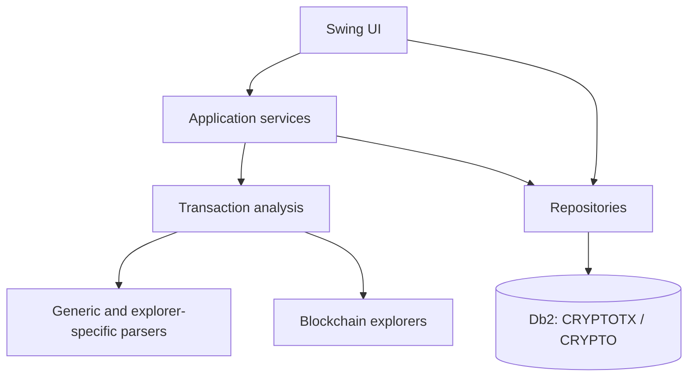
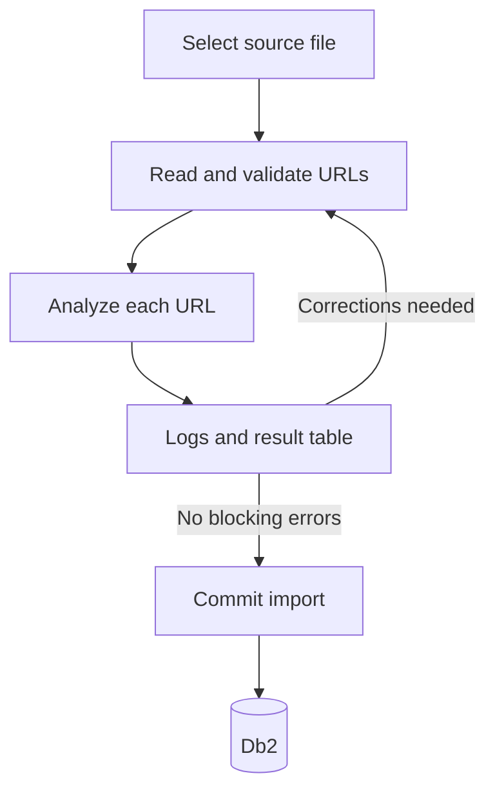

# Application architecture

**Crypto Transaction Manager** is a Java Swing desktop application organized around a
small layered architecture. The user interface coordinates user actions, services perform
multi-step operations, repositories encapsulate JDBC, and models carry domain data.

## Main components

The current source uses the base package `com.pacovalverde.cryptotx`. Personal naming is
reserved for the Java namespace; database objects use neutral domain names such as the
`CRYPTO` schema.

## Package responsibilities

| Package | Responsibility | Representative classes |
|---|---|---|
| `app` | Application entry point and dependency construction | `Main` |
| `ui` | Top-level Swing windows | `MainWindow` |
| `ui.form` | CRUD and workflow panels | `BlockchainPanel`, `MovementPanel` |
| `ui.dialog` | Focused modal dialogs | `HtmlSourceDialog` |
| `model` | Domain objects and persistence-shaped data | `Blockchain`, `Movement`, `MovementCryptocurrency`, `MovementWebData` |
| `repository` | SQL, JDBC mapping, and table-level persistence | `BlockchainRepository`, `MovementRepository`, `MovementDetailsRepository` |
| `service` | Multi-table transactions and business workflows | `MovementService`, `TransactionAnalyzerService` |
| `parser` | Generic and explorer-specific parsing logic | Parser implementations as support is added |
| `importer` | File reading, URL validation, preview, and commit | Import workflow classes |

Database configuration and connection classes currently come from
`com.pacovalverde.jdbc.database.db2`. Password decryption is supplied by
`com.pacovalverde.cipher.security.AesCipher`.

## Startup sequence

The current `Main` class performs manual dependency injection:

1. Schedule startup on the Swing Event Dispatch Thread with
   `SwingUtilities.invokeLater`.
2. Load the local Db2 configuration through `Db2ConfigLoader`.
3. Decrypt the configured database password.
4. Create one `Db2ConnectionFactory`.
5. Construct repositories with that connection factory.
6. Construct `MovementService` and `TransactionAnalyzerService`.
7. Inject those dependencies into `MainWindow`.
8. Display the window.

If configuration, decryption, the JDBC driver, or the database connection fails, startup
shows an error dialog and does not create a partially initialized UI.

The current `Main` snapshot contains a machine-specific configuration path and an embedded
decryption password. These are development placeholders, not a distributable design. Move
both values to safe local configuration before releasing the application; never commit real
credentials or encryption secrets.

## User interface layer

`MainWindow` owns the menu and a `JTabbedPane`. The project exposes these functional areas:

- Blockchain
- Protocol
- Cryptocurrency
- Own Addresses
- Movement
- Import Movements

CRUD panels follow a common interaction model: load table data, select a row, create or edit
a record, save or cancel, delete when allowed, and reload explicitly. An explicit **Reload**
action remains useful even when save operations refresh the table because another process or
user may modify the same database.

Network and analysis work must not run on the Event Dispatch Thread. `MovementPanel` follows
this rule by running `TransactionAnalyzerService.analyze(url)` in a `SwingWorker` and applying
the result in `done()`.

`HtmlSourceDialog` is a read-only view for stored HTML with search and copy support. It is a
UI concern; acquisition and persistence remain outside the dialog.

## Repository layer

Repositories receive a `Db2ConnectionFactory` and use prepared statements. Their contract is
table-focused:

- Execute schema-qualified SQL, such as `CRYPTO.MOVEMENT`.
- Convert nullable Db2 values without losing `NULL` semantics.
- Map rows to model objects.
- Close connections, statements, and result sets with try-with-resources.
- Verify that updates and deletes affect the expected number of rows.
- Let services control a shared connection when one business operation spans several tables.

`MovementRepository` illustrates both styles: convenience methods open their own connection,
while overloads accepting a `Connection` allow `MovementService` to participate in one JDBC
transaction.

Generated identity values are obtained from Db2 using `FINAL TABLE (INSERT ...)`, so Java
does not calculate primary keys.

## Service layer

Services are used when a task is broader than one table or one panel.

### `MovementService`

A movement save can affect:

- `CRYPTO.MOVEMENT`
- `CRYPTO.MOVEMENT_CRYPTOCURRENCY`
- `CRYPTO.MOVEMENT_WEB_DATA`

These changes should be committed atomically. On failure, the service should roll the JDBC
transaction back so a movement is not saved without its associated assets or web data.

### `TransactionAnalyzerService`

The analyzer coordinates URL processing and converts parser output into a
`TransactionAnalysisResult`. The UI can then populate:

- blockchain and protocol
- transaction hash, timestamp, type, and status
- caller/from and interacted-with/to addresses
- automatic description
- assets and their roles or amounts
- HTTP status, fetch status, content type, stored HTML, and errors

Catalogs such as blockchains, protocols, cryptocurrencies, and owned addresses are loaded
from repositories. Reload them before analysis when catalog records may have changed.

## Parser strategy

Explorer pages differ by network, vendor, transaction type, and site version. The intended
strategy is layered:

1. Detect the explorer and blockchain from the URL and catalog.
2. Fetch the page and retain the original response metadata and HTML.
3. Apply generic extraction for common fields.
4. Dispatch to an explorer- or protocol-specific parser when generic extraction is
   insufficient.
5. Merge recognized fields and record warnings for partial results.

Representative cases already considered by the project include Algorand transaction groups
on Allo for pact.fi actions and Avalanche C-Chain transactions displayed by Snowtrace or
Routescan, including Aave deposits.

Parser failures should degrade to a partial result rather than discard the original URL and
HTML. See [Adding parsers](../development/adding-parsers.md).

## Import workflow

The preview/commit split is intentional. Detection results can be reviewed before permanent
database changes are made. TXT is the first active format; CSV, spreadsheet, and PDF support
can be introduced behind the same workflow later.

## Dependency direction

Keep dependencies pointing inward toward domain and persistence abstractions:

- UI may call services and repositories.
- Services may call repositories and parsers.
- Parsers should return result objects and should not manipulate Swing controls.
- Repositories should not depend on UI classes.
- Models should not open database connections or perform HTTP requests.

This separation allows parsers and repositories to be tested without opening the full Swing
application.

## Error handling and observability

- Show concise, actionable messages in dialogs or the import log.
- Preserve the underlying exception for console or application logging during development.
- Distinguish HTTP failure from parsing failure.
- Store `HTTP_STATUS`, `FETCH_STATUS`, and `ERROR_MESSAGE` when analysis reaches the web-data
  stage.
- Return warnings for partial extraction; do not present partial data as fully verified.
- Never overwrite user-authored descriptions with a later automatic analysis.

## Extension points

The architecture is designed to grow through additions rather than large conditional blocks:

- new blockchain catalog rows
- new explorer detectors and parsers
- new protocol-specific interpretation
- new import-source readers
- normalized catalogs for movement types or statuses if needed
- future wallet balances, positions, prices, or tax-oriented classifications

For database details, see [Database design](database-design.md).
