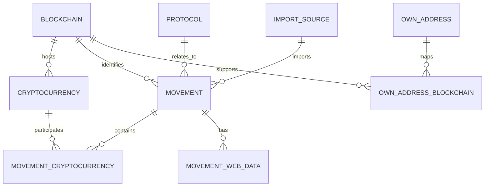

# Database design

This document describes the relational model used by **Crypto Transaction Manager**.
It reflects the current Db2 DDL and the decisions recorded for the project.

## Scope

The first version of the application records and analyzes blockchain operations obtained
from explorer URLs or entered manually. The model must support transactions that are more
complex than a transfer, including swaps, lending, staking, liquidity operations, rewards,
bridges, approvals, and governance actions.

The physical Db2 database and application schema are deliberately independent:

| Object | Name |
|---|---|
| Database | `CRYPTOTX` |
| Schema | `CRYPTO` |

`CRYPTOTX` respects the eight-character limit used for the physical database name in the
current Db2 environment. All application tables are stored under `CRYPTO`.

## Relational overview

Every SQL example should use the schema-qualified name, for example
`CRYPTO.MOVEMENT`, even after executing `SET CURRENT SCHEMA CRYPTO`.

## Tables

### `CRYPTO.BLOCKCHAIN`

Catalog of blockchain networks supported or recognized by the application.

| Column | Db2 type | Rules and purpose |
|---|---|---|
| `ID` | `BIGINT` | Identity primary key |
| `NAME` | `VARCHAR(100)` | Required network name |
| `SYMBOL` | `VARCHAR(20)` | Native asset symbol or short identifier |
| `CHAIN_ID` | `VARCHAR(50)` | EVM chain ID or a non-EVM network identifier |
| `EXPLORER_URL` | `VARCHAR(500)` | Preferred explorer base URL |
| `ACTIVE` | `SMALLINT` | Required; `1` by default |

`CHAIN_ID` is text rather than numeric because identifiers such as `osmosis-1` and
`kava_2222-10` are valid alongside numeric EVM chain IDs.

### `CRYPTO.PROTOCOL`

Catalog of protocols, exchanges, wallets, bridges, and other platforms involved in a
movement.

| Column | Db2 type | Rules and purpose |
|---|---|---|
| `ID` | `BIGINT` | Identity primary key |
| `NAME` | `VARCHAR(150)` | Required display name |
| `TYPE` | `VARCHAR(40)` | `DEX`, `LENDING`, `CEX`, `WALLET`, `BRIDGE`, `STAKING`, etc. |
| `WEBSITE` | `VARCHAR(500)` | Main website |
| `ACTIVE` | `SMALLINT` | Required; `1` by default |

Examples in the initial data include Aave, Folks Finance, pact.fi, Venus Protocol,
Moola Market, Binance, MEXC, and MetaMask.

### `CRYPTO.IMPORT_SOURCE`

Stores information about a file-import operation and provides traceability for imported
movements.

| Column | Db2 type | Purpose |
|---|---|---|
| `ID` | `BIGINT` | Identity primary key |
| `FILE_NAME` | `VARCHAR(255)` | Imported file name |
| `FILE_PATH` | `VARCHAR(1000)` | Original path, when retained |
| `IMPORTED_AT` | `TIMESTAMP` | Import date and time |
| `TOTAL_LINES` | `INTEGER` | Lines read |
| `TOTAL_URLS` | `INTEGER` | URLs detected |
| `TOTAL_IMPORTED` | `INTEGER` | Rows committed successfully |
| `TOTAL_ERRORS` | `INTEGER` | Import errors |

### `CRYPTO.CRYPTOCURRENCY`

Catalog of native assets and tokens. Assets are associated with a blockchain whenever it
is known.

| Column | Db2 type | Rules and purpose |
|---|---|---|
| `ID` | `BIGINT` | Identity primary key |
| `BLOCKCHAIN_ID` | `BIGINT` | Nullable FK to `CRYPTO.BLOCKCHAIN.ID` |
| `NAME` | `VARCHAR(150)` | Asset name |
| `TICKER` | `VARCHAR(30)` | Display symbol |
| `CONTRACT_ADDRESS` | `VARCHAR(255)` | Token contract, when applicable |
| `DECIMALS` | `SMALLINT` | Asset decimal places |
| `IS_NATIVE` | `SMALLINT` | `1` for a native asset; otherwise `0` |
| `ACTIVE` | `SMALLINT` | Required; `1` by default |

A ticker is not globally unique. `USDC`, `USDT`, wrapped assets, and bridged assets can
exist as distinct contracts on several networks. Resolution should prefer the combination
of blockchain and contract address; blockchain plus ticker is only a fallback.

### `CRYPTO.OWN_ADDRESS`

Catalog of addresses controlled or monitored by the user.

| Column | Db2 type | Rules and purpose |
|---|---|---|
| `ID` | `BIGINT` | Identity primary key |
| `ADDRESS` | `VARCHAR(255)` | Required and unique |
| `LABEL` | `VARCHAR(150)` | Human-readable label |
| `NOTES` | `VARCHAR(1000)` | Optional notes |
| `SOFT_DELETED` | `SMALLINT` | Required; `0` by default |

Soft deletion preserves historical associations while allowing an address to disappear
from normal active lists.

### `CRYPTO.OWN_ADDRESS_BLOCKCHAIN`

Join table associating one owned address with one or several compatible blockchains.

| Column | Db2 type | Rules and purpose |
|---|---|---|
| `ID` | `BIGINT` | Identity primary key |
| `OWN_ADDRESS_ID` | `BIGINT` | Required FK to `CRYPTO.OWN_ADDRESS.ID` |
| `BLOCKCHAIN_ID` | `BIGINT` | Required FK to `CRYPTO.BLOCKCHAIN.ID` |

The pair `(OWN_ADDRESS_ID, BLOCKCHAIN_ID)` is unique. This is especially useful for an
EVM address that is valid on multiple EVM-compatible networks.

### `CRYPTO.MOVEMENT`

Central record representing one imported or manually entered blockchain operation.

| Column | Db2 type | Rules and purpose |
|---|---|---|
| `ID` | `BIGINT` | Identity primary key |
| `BLOCKCHAIN_ID` | `BIGINT` | Nullable FK to `CRYPTO.BLOCKCHAIN.ID` |
| `URL` | `VARCHAR(2048)` | Original explorer URL |
| `TX_HASH` | `VARCHAR(255)` | Transaction hash or group identifier |
| `MOVEMENT_TYPE` | `VARCHAR(40)` | Operation classification |
| `AUTO_DESCR` | `VARCHAR(2000)` | Description produced by analysis |
| `USER_DESCR` | `VARCHAR(2000)` | User correction or annotation |
| `TX_TIMESTAMP` | `TIMESTAMP` | On-chain transaction time |
| `STATUS` | `VARCHAR(30)` | `CONFIRMED`, `FAILED`, `PENDING`, `UNKNOWN`, etc. |
| `FROM_ADDRESS` | `VARCHAR(255)` | Origin/caller address, when available |
| `TO_ADDRESS` | `VARCHAR(255)` | Destination/interacted address, when available |
| `PROTOCOL_ID` | `BIGINT` | Nullable FK to `CRYPTO.PROTOCOL.ID` |
| `IMPORT_SOURCE_ID` | `BIGINT` | Nullable FK to `CRYPTO.IMPORT_SOURCE.ID` |
| `CREATED_AT` | `TIMESTAMP` | Row creation time |
| `UPDATED_AT` | `TIMESTAMP` | Last modification time |

`FROM_ADDRESS` and `TO_ADDRESS` deliberately remain text columns. Most external addresses
do not belong in `OWN_ADDRESS`, and either side of a transaction may be controlled by the
user.

Suggested movement types include `TRANSFER`, `SWAP`, `DEPOSIT`, `WITHDRAW`, `STAKE`,
`UNSTAKE`, `CLAIM`, `BORROW`, `REPAY`, `SUPPLY`, `APPROVE`, `BRIDGE`,
`ADD_LIQUIDITY`, `REMOVE_LIQUIDITY`, `GOVERNANCE`, and `UNKNOWN`.

### `CRYPTO.MOVEMENT_CRYPTOCURRENCY`

Resolves the many-to-many relationship between movements and assets.

| Column | Db2 type | Rules and purpose |
|---|---|---|
| `ID` | `BIGINT` | Identity primary key |
| `MOVEMENT_ID` | `BIGINT` | FK to `CRYPTO.MOVEMENT.ID` |
| `CRYPTOCURRENCY_ID` | `BIGINT` | FK to `CRYPTO.CRYPTOCURRENCY.ID` |
| `ROLE` | `VARCHAR(30)` | `INPUT`, `OUTPUT`, `FEE`, `COLLATERAL`, `REWARD`, etc. |
| `AMOUNT` | `DECIMAL(31,18)` | Exact asset quantity |
| `VALUE_USD` | `DECIMAL(20,8)` | Optional USD value at transaction time |
| `VALUE_EUR` | `DECIMAL(20,8)` | Optional EUR value at transaction time |

The current Db2 DDL uses `DECIMAL(31,18)` for `AMOUNT`. Do not change it to
`DECIMAL(38,18)` without verifying the target Db2 edition and its maximum supported
precision; that definition failed in the development environment.

A swap such as `100 USDC -> 0.021 PAXG` becomes two rows: USDC with role `INPUT` and
PAXG with role `OUTPUT`.

### `CRYPTO.MOVEMENT_WEB_DATA`

Stores the HTTP response metadata and HTML used during transaction analysis.

| Column | Db2 type | Purpose |
|---|---|---|
| `ID` | `BIGINT` | Identity primary key |
| `MOVEMENT_ID` | `BIGINT` | FK to `CRYPTO.MOVEMENT.ID` |
| `HTTP_STATUS` | `INTEGER` | HTTP status code, when available |
| `FETCH_STATUS` | `VARCHAR(30)` | `OK`, `ERROR`, `BLOCKED`, `TIMEOUT`, etc. |
| `CONTENT_TYPE` | `VARCHAR(150)` | Response media type |
| `HTML_CONTENT` | `CLOB` | Downloaded HTML text |
| `FETCHED_AT` | `TIMESTAMP` | Acquisition time |
| `ERROR_MESSAGE` | `VARCHAR(2000)` | Fetch or analysis error details |

HTML is textual and is therefore stored as `CLOB`, not `BLOB`.

## Integrity and indexes

The current DDL defines primary keys and the main foreign keys. The setup repository also
reserves separate scripts for indexes and additional constraints. The following rules are
recommended:

- Keep `OWN_ADDRESS.ADDRESS` unique.
- Keep `(OWN_ADDRESS_ID, BLOCKCHAIN_ID)` unique in `OWN_ADDRESS_BLOCKCHAIN`.
- Make `MOVEMENT.URL` unique if one explorer URL must represent exactly one source
  movement. Normalize URLs before enforcing this rule because equivalent URLs can differ
  syntactically.
- Index `MOVEMENT.TX_HASH`, `MOVEMENT.BLOCKCHAIN_ID`, `MOVEMENT.PROTOCOL_ID`, and
  `MOVEMENT.IMPORT_SOURCE_ID`.
- Index both foreign-key columns in `MOVEMENT_CRYPTOCURRENCY`.
- Consider a unique rule for blockchain plus contract address when a contract is present.
- Do not define a global unique constraint on `CRYPTOCURRENCY.TICKER`.

## Db2-to-Java mapping

| Db2 type | Java type |
|---|---|
| `BIGINT` | `long` / `Long` |
| `VARCHAR` | `String` |
| `SMALLINT` flags | `boolean` or `int`, mapped consistently |
| `DECIMAL` | `java.math.BigDecimal` |
| `TIMESTAMP` | `java.sql.Timestamp` in the current model |
| `CLOB` | `String` or character stream |

Never use `float` or `double` for persisted cryptocurrency amounts when decimal precision
must be exact.

## Evolution rules

- During early development, rebuilding a disposable database from the numbered DDL scripts
  is acceptable.
- Once existing data must be preserved, introduce versioned migration scripts rather than
  editing an already-released schema silently.
- Update this document, the DDL, Java models, repositories, and tests in the same change.
- Keep automatic analysis separate from user-verified information. `AUTO_DESCR` and
  `USER_DESCR` are the first example of this rule.

See also [Database conventions](../development/database-conventions.md) and
[Database setup](../installation/database-setup.md).
