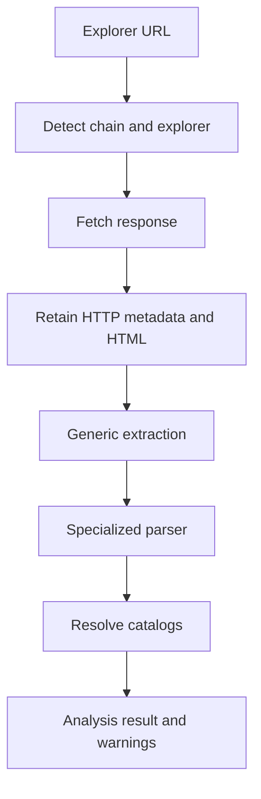

# Adding transaction parsers

Blockchain explorers do not expose one stable HTML structure. Parser support is therefore
incremental: retain the source response, extract generic fields where possible, then apply
specialized logic for explorers or protocols that need it.

## Design goals

A parser should:

- recognize only URLs or documents it genuinely supports
- extract structured data without depending on Swing controls or JDBC
- return partial results with warnings when some fields cannot be resolved
- preserve exact decimal values with `BigDecimal`
- never invent a blockchain, protocol, token, amount, or direction
- be testable from local fixtures
- fail safely when an explorer changes its page

## Processing pipeline



Fetching and parsing should remain separable. A parser that accepts supplied HTML can be tested
without network access.

## Parser contract

Adapt the names to the actual main repository, but keep the contract small. An illustrative
interface is:

```java
public interface TransactionParser {

    boolean supports(ParserContext context);

    ParsedTransaction parse(ParserContext context)
            throws TransactionParseException;
}
```

`ParserContext` can contain:

- normalized URL and parsed URI
- detected blockchain/explorer
- HTTP status and content type
- HTML or embedded structured data
- optional generic extraction result

`ParsedTransaction` should carry only parsed domain data and warnings, for example:

- transaction hash/group identifier
- timestamp
- status
- movement type
- from/caller and to/interacted-with addresses
- protocol hint
- automatic description
- asset candidates with ticker, contract, role, and `BigDecimal` amount
- confidence or provenance when supported by the model

Do not return repository entities with invented IDs from parser code. Catalog resolution belongs
in the coordinating service.

## Parser selection

Use deterministic precedence:

1. Exact network/explorer/protocol specialization.
2. Explorer-family parser.
3. Generic parser.
4. Unsupported/partial result.

If several parsers claim the same document, detect that conflict in tests. Avoid an unordered
loop whose result changes when class registration order changes accidentally.

`supports` should inspect structured URI data and, if necessary, explicit page markers. Do not
match a common word anywhere in the full URL or HTML.

## Generic extraction

Generic extraction can identify fields that recur across explorer families:

- title and transaction hash
- timestamp markers
- status labels
- from/caller and to/interacted-with addresses
- native value and fee
- token-transfer tables
- method name or decoded call label
- embedded JSON application state

Generic extraction must not assume that the first transfer is the user's economic input or that
the last transfer is the output. Contract interactions may include approvals, mint/burn events,
receipt tokens, internal transfers, and fees.

## Specialized examples

### Algorand / Allo transaction groups

Allo URLs can identify a transaction **group**, not a single transaction. A pact.fi claim,
unstake, or pool withdrawal may require combining several transfers and application calls before
describing the user's net result.

Tests should cover:

- URL-encoded group identifiers
- multiple transactions in one group
- claim and unstake combinations
- liquidity-pool tokens such as PLP
- correct asset direction from the perspective of an owned address

### Avalanche / Snowtrace or Routescan

An Avalanche C-Chain Aave supply is EVM-compatible but may expose insufficient data to a purely
generic HTML parser. Specialized logic may need to inspect decoded inputs, logs/token transfers,
and protocol-specific labels to derive `SUPPLY` or `DEPOSIT`, USDC amount, and Aave protocol.

Tests should also confirm that previously supported generic EVM transfers continue to work.

### Shared Blockscout or Mintscan families

Shared explorer software can justify a family parser, but network-specific deployments and page
versions can differ. Keep host/path fixtures per supported deployment instead of assuming one
sample proves every chain.

## Owned-address perspective

Direction often depends on whether a known owned address appears as sender, recipient, caller, or
beneficiary. `TransactionAnalyzerService` has access to the owned-address catalog; keep that
context outside raw HTML selectors where possible.

Examples:

- transfer from owned address: asset role `OUTPUT`
- transfer to owned address: asset role `INPUT`
- gas paid by owned caller: `FEE`
- claim received by owned address: `REWARD`
- supply to lending protocol: supplied asset may be `INPUT` or a dedicated supply role according
  to the project's current vocabulary

Document the selected role vocabulary and use it consistently. Do not change historical role
semantics inside one parser.

## Token resolution

Prefer these identifiers in order:

1. detected blockchain plus verified contract address
2. detected blockchain plus asset identifier native to that chain
3. detected blockchain plus ticker/name as a cautious fallback

Never resolve globally by ticker. If a parser finds an unknown contract, return the contract,
ticker/name hint, decimals when known, and a warning. Let the UI or service mark it unresolved
instead of assigning the wrong `CRYPTOCURRENCY_ID`.

Parse raw integer token quantities using the token's decimals and `BigDecimal`:

```java
BigDecimal amount = new BigDecimal(rawAmount)
        .movePointLeft(decimals);
```

Do not pass through `double`.

## Fetching rules

- Use finite connect and read timeouts.
- Follow redirects according to a documented policy.
- Record final HTTP status, content type, fetch time, and error text.
- A failed `HEAD` does not prove a page is unavailable; some explorers allow `GET` but reject
  `HEAD`.
- Identify blocked, timeout, HTTP error, empty, and unsupported-content cases separately.
- Do not bypass access controls or anti-bot measures.
- Rate-limit repeated live tests and prefer saved fixtures.

Even when parsing fails, retain permitted HTML and response metadata in the analysis result so
the user can inspect it in `HtmlSourceDialog` and future parsers can be improved.

## Error and warning policy

Use an exception for a parser failure that prevents meaningful processing. Use warnings for
partial extraction:

- blockchain recognized, operation unknown
- transaction metadata found, token unresolved
- amount found, direction uncertain
- page fetched, expected section absent
- parser version no longer matches known page markers

The UI already distinguishes successful analysis from analysis with warnings. Avoid returning
an apparently complete result filled with guessed defaults.

## Testing strategy

### Unit tests

For each parser, test local fixtures for:

- `supports` positive and negative cases
- status and transaction identifier
- timestamp and address extraction
- movement classification
- every expected asset, role, amount, and contract
- warnings for missing optional sections
- clear failure on malformed input
- locale differences in number formatting when the explorer localizes output

### Regression tests

Maintain tests for older explorers whenever a generic or family parser changes. The central
requirement is that adding specialized support must not break already working transactions.

### Live smoke tests

Run a small opt-in live suite against representative public URLs. Do not make normal unit tests
depend on internet availability or a third-party site's current HTML.

## Registration checklist

When implementation is complete:

- register the parser in the explicit parser registry/factory
- document its precedence
- inject it through the analyzer rather than constructing it in a Swing panel
- update supported explorer documentation
- add sanitized fixtures and expected results
- add a negative fixture from the same host
- run generic and existing parser regression tests
- verify the analysis result maps correctly into `MovementPanel`
- save and reload a test movement with its assets and web data

## Maintenance when an explorer changes

1. Reproduce with a known fixture and a current permitted response.
2. Determine whether fetching, detection, selection, or interpretation failed.
3. Add the failing response as a sanitized regression fixture when allowed.
4. Make the smallest parser change that restores the contract.
5. Preserve older fixtures if the explorer may serve both layouts.
6. Record a warning or explicit unsupported version if safe extraction is no longer possible.
7. Never delete stored source HTML merely because the current parser cannot read it.
